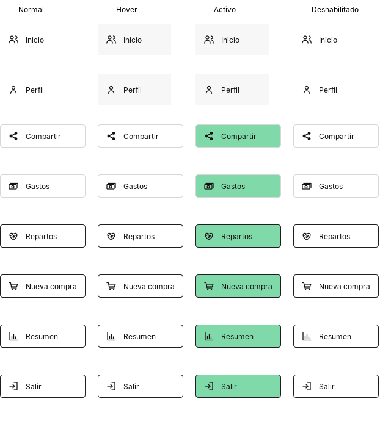

# BymetooBotones - Botones personalizados

Proyecto Java con Ant (NetBeans) con los 8 botones personalizados de la app
Bymetoo. Cada botón es un componente independiente y al pulsarlo cambia de
view solo.



| Botón | Abre |
|---|---|
| `BotonInicio` | `vista.MainView` |
| `BotonPerfil` | `vista.UserView` |
| `BotonCompartir` | `vista.GroupView` |
| `BotonGastos` | `vista.MainView` |
| `BotonRepartos` | `vista.RepartosView` |
| `BotonNuevaCompra` | `vista.CompraWindow` |
| `BotonResumen` | `vista.ResumenView` |
| `BotonSalir` | `vista.LoginView` |

Si alguno tiene que ir a otra ventana se cambia en *Properties → ventanaDestino*.
Si la ventana no existe, el botón sale deshabilitado.

## Estructura

```
BymetooBotones/
├── src/
│   ├── com/bymetoo/componentes/
│   │   ├── BotonBymetoo.java          clase padre (JPanel)
│   │   ├── BotonInicio.java ...       los 8 botones
│   │   ├── BotonInicioBeanInfo.java ...  un BeanInfo por botón
│   │   ├── BeanInfoBotonBase.java     lo común de los BeanInfo
│   │   ├── BotonBymetooEvent.java     evento propio
│   │   ├── BotonBymetooListener.java  listener
│   │   ├── BotonBymetooAdapter.java   adapter
│   │   └── EstadoBoton, EstiloBoton, TipoIcono, IconoNavegacion
│   └── iconos/                        iconos de la paleta (16x16 y 32x32)
├── manifest.mf                        Java-Bean: True de los 8 botones
├── dist/BymetooBotones.jar            el JAR para usar en la app
└── docs/                              diagrama UML (.dia y .md)
```

## Generar el JAR

Abrir el proyecto en NetBeans → clic derecho → *Clean and Build*.
El JAR sale en `dist/BymetooBotones.jar`.

## Usar los botones en la app

1. En el proyecto de la app: *Libraries → Add JAR/Folder* → `BymetooBotones.jar`.
2. *Tools → Palette → Swing/AWT Components → Add from JAR...* → elegir el JAR →
   marcar los 8 botones → categoría "Bymetoo".
3. Arrastrar los botones a las vistas en modo *Design*.

## Evento propio

Cada botón lanza `BotonBymetooEvent`:

- `estadoCambiado(e)`: cuando pasa a NORMAL, HOVER, ACTIVO o DESHABILITADO.
- `botonPulsado(e)`: al pulsarlo, antes de cambiar de ventana. Con
  `e.cancelarNavegacion()` no cambia.

En Matisse: clic derecho en el botón → *Events → botonBymetoo → botonPulsado*.

## Reparto del trabajo

- **Botones (este proyecto)**: la clase con sus atributos (color, tamaño,
  estado), getters/setters, valores por defecto, el evento con su listener, el
  cambio de view, los comentarios Javadoc y el diagrama UML.
- **Feedback visual (Elias)**: cómo se ve cada estado. El `paintComponent` que
  hay ahora es solo un ejemplo.
- **Pruebas y generar el Javadoc**: lo hacen otros compañeros.
