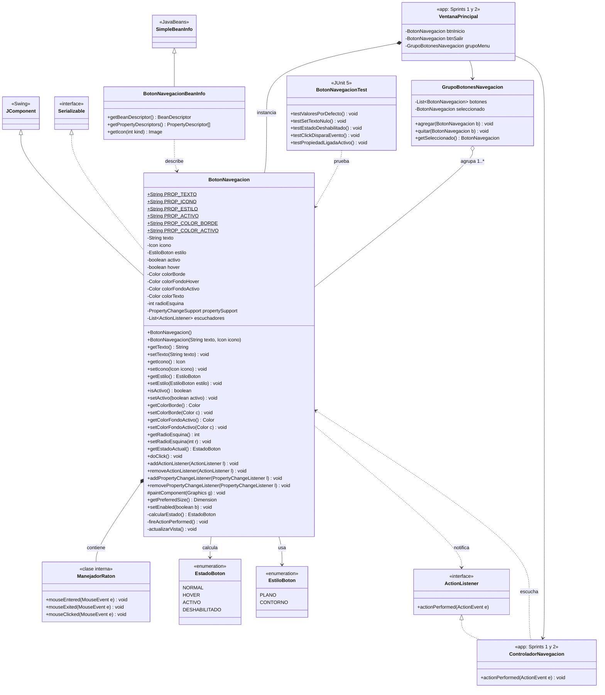
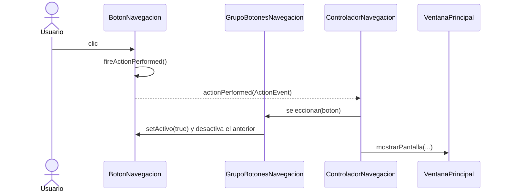

# Sprint 3 · T-3.1.1 — Arquitectura del componente `BotonNavegacion`

Paquete: `com.dam.interfaces.componentes` · Java puro (Swing + JavaBeans) · Ant/NetBeans

## 1. Análisis del mockup

| Elemento del mockup | Decisión de diseño |
|---|---|
| Icono + texto en todos los botones | Propiedades `icono` (`Icon`) y `texto` (`String`) |
| Inicio / Perfil: sin borde, fondo gris claro en Hover y Activo | `EstiloBoton.PLANO` |
| Compartir / Gastos: borde gris claro, Activo verde | `EstiloBoton.CONTORNO` + `colorBorde` gris |
| Repartos / Nueva compra / Resumen / Salir: borde negro, Activo verde | `EstiloBoton.CONTORNO` + `colorBorde` negro |
| 4 columnas: Normal, Hover, Activo, Deshabilitado | `enum EstadoBoton` calculado, nunca asignado a mano |
| Esquinas redondeadas | Propiedad `radioEsquina` |

Un solo componente con propiedades configurables evita cinco clases casi idénticas y permite que el equipo lo arrastre desde la paleta de Matisse.

## 2. Diagrama de clases (UML)

## 3. Reglas del componente

### Cálculo del estado (prioridad de arriba abajo)

| Prioridad | Condición | Estado | Aspecto según mockup |
|---|---|---|---|
| 1 | `!isEnabled()` | `DESHABILITADO` | Igual que Normal, sin reaccionar al ratón |
| 2 | `activo == true` | `ACTIVO` | PLANO: fondo gris claro. CONTORNO: fondo verde |
| 3 | `hover == true` | `HOVER` | PLANO: fondo gris claro. CONTORNO: igual que Normal |
| 4 | resto | `NORMAL` | Sin fondo; borde solo en CONTORNO |

El estado **no** tiene setter: se deriva de `enabled`, `activo` y `hover`. Así es imposible dejar el componente en un estado incoherente.

### Encapsulación
- Todos los atributos son `private`; solo se accede por getters y setters.
- Cada setter compara el valor antiguo con el nuevo, lo guarda, llama a `firePropertyChange(...)` y luego a `actualizarVista()` (`revalidate()` + `repaint()`).
- `setTexto(null)` se convierte en `""`; `setColorBorde(null)` y `setColorFondoActivo(null)` restauran el valor por defecto; `radioEsquina < 0` se ajusta a 0.

### Valores por defecto (constructor sin argumentos)

| Propiedad | Valor |
|---|---|
| `texto` | `"Botón"` |
| `icono` | `null` |
| `estilo` | `CONTORNO` |
| `activo` | `false` |
| `colorBorde` | negro |
| `colorFondoActivo` | verde del mockup (≈ `#80D9A8`) |
| `colorFondoHover` | gris claro (≈ `#F7F8F7`) |
| `colorTexto` | negro |
| `radioEsquina` | 8 |

## 4. Eventos

| Origen | Mecanismo | Resultado |
|---|---|---|
| Ratón entra o sale | `ManejadorRaton.mouseEntered/Exited` | Cambia `hover`, se repinta y se recalcula el estado |
| Clic con el botón habilitado | `ManejadorRaton.mouseClicked` | `fireActionPerformed()` a todos los `ActionListener` registrados |
| Cambio de propiedad | `PropertyChangeSupport` | `PropertyChangeEvent` con valor antiguo y nuevo |
| Teclado (opcional) | `KeyListener` con Enter o Espacio | Llama a `doClick()` |

Registro y baja de observadores: `addActionListener` / `removeActionListener` y `addPropertyChangeListener` / `removePropertyChangeListener`.

## 5. Relación con la lógica de la app

- El componente **no conoce** la aplicación: solo emite eventos. Eso permite empaquetarlo en `.jar` (T-3.4.1) y reutilizarlo (T-3.5.1).
- `ControladorNavegacion` es el único punto de unión con la lógica de los Sprints 1 y 2.
- `GrupoBotonesNavegacion` hace que solo un botón del menú lateral esté en estado ACTIVO, como en la columna "Activo" del mockup.

## 6. Reparto por tarea del SOW

| Tarea | Rol | Qué implementa de este diseño |
|---|---|---|
| T-3.1.1 | Scrum Master | `BotonNavegacion` (atributos, constructores, getters y setters), enums |
| T-3.2.1 | Frontend | `ManejadorRaton`, `paintComponent`, `fireActionPerformed`, add/remove listener |
| T-3.3.1 | QA | `BotonNavegacionTest` (JUnit 5 con `invokeAndWait`) |
| T-3.4.1 | QA + Release | Javadoc, `BotonNavegacionBeanInfo`, `manifest.mf`, `.jar` |
| T-3.5.1 | Todo el equipo | `VentanaPrincipal` + `ControladorNavegacion` usando el `.jar` |

## 7. Cumplimiento JavaBeans y Javadoc

- Clase `public`, `implements Serializable`, constructor público sin argumentos.
- Propiedades con `getX` / `setX` (`isActivo` para el booleano) y propiedades ligadas con `PropertyChangeSupport`.
- Constantes `PROP_*` documentadas con Javadoc.
- Bloques `/** */` con `@param`, `@return` y `@throws`; sin `<ul>` dentro de `
`, sin saltar a `<h3>`, y `package-info.java` en el paquete.
- Codificación UTF-8 en todo el proyecto.

