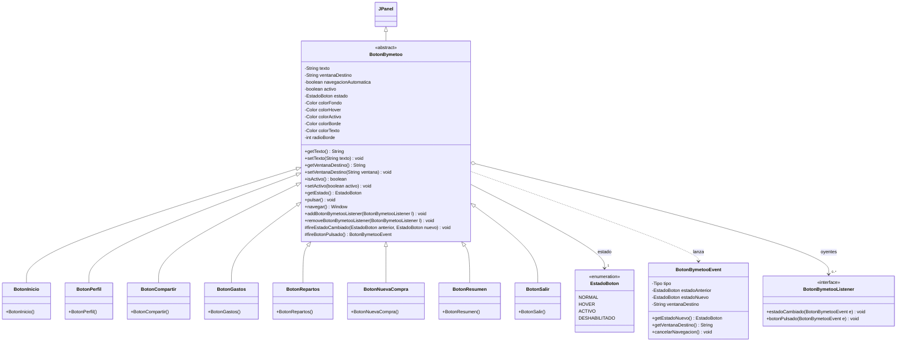

# Diagrama de clases - Botones Bymetoo

Diagrama UML de los botones personalizados de la app Bymetoo.

## Qué significa cada cosa

- **JPanel → BotonBymetoo**: BotonBymetoo hereda de JPanel, así que es un componente de Swing.
- **BotonBymetoo**: es la clase padre (abstracta). Tiene todo lo común: propiedades, estados, eventos y el cambio de ventana.
- **Los 8 botones** (BotonInicio, BotonPerfil...): heredan de BotonBymetoo y solo dicen su texto, su icono y a qué ventana van.
- **EstadoBoton**: los 4 estados del boceto. Cada botón tiene 1 estado en cada momento.
- **BotonBymetooEvent**: el evento propio. El botón lo lanza cuando cambia de estado o cuando se pulsa.
- **BotonBymetooListener**: la interfaz para escuchar los eventos. Un botón puede tener 0 o muchos listeners (oyentes).

## Leyenda

| Símbolo | Significado |
|---|---|
| `-` | privado |
| `+` | público |
| `#` | protegido |
| Flecha con triángulo | herencia |
| Flecha discontinua | dependencia (lo usa) |
| Rombo | agregación (tiene una lista de) |
