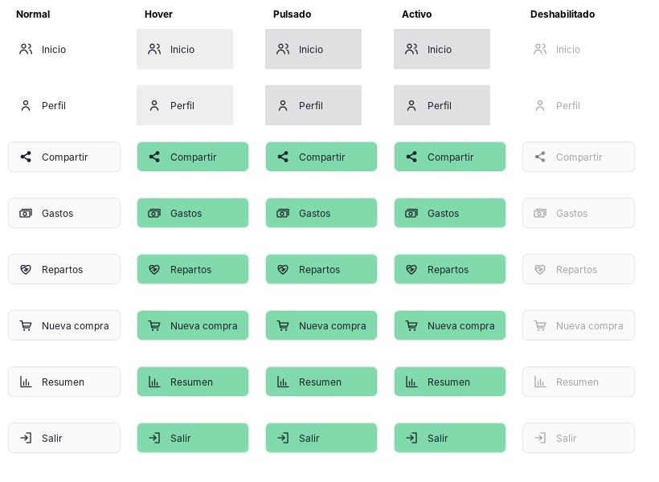

# BymetooBotones - Botones personalizados

Proyecto Java Swing con Ant (NetBeans) que contiene ocho botones personalizados
de Bymetoo. Cada botón es un componente reutilizable y puede navegar a una
ventana de la aplicación que lo integre.



| Botón | Ventana de destino predeterminada |
|---|---|
| `BotonInicio` | `vista.MainView` |
| `BotonPerfil` | `vista.UserView` |
| `BotonCompartir` | `vista.GroupView` |
| `BotonGastos` | `vista.MainView` |
| `BotonRepartos` | `vista.RepartosView` |
| `BotonNuevaCompra` | `vista.CompraWindow` |
| `BotonResumen` | `vista.ResumenView` |
| `BotonSalir` | `vista.LoginView` |

El destino se puede cambiar desde la propiedad `ventanaDestino`. Si la ventana
indicada no existe en el proyecto consumidor, el botón puede quedar
deshabilitado al añadirse a la ventana.

## Estructura

```text
componentes/
├── src/
│   ├── com/bymetoo/componentes/
│   │   ├── BotonBymetoo.java
│   │   ├── BotonInicio.java ... (ocho botones)
│   │   ├── BotonInicioBeanInfo.java ... (un BeanInfo por botón)
│   │   ├── BeanInfoBotonBase.java
│   │   ├── BotonBymetooEvent.java
│   │   ├── BotonBymetooListener.java
│   │   ├── BotonBymetooAdapter.java
│   │   ├── AyudaContextual.java
│   │   └── EstadoBoton, EstiloBoton, TipoIcono, IconoNavegacion
│   └── iconos/
├── manifest.mf
├── build.xml
├── dist/BymetooBotones.jar
└── docs/
```

## Generar el JAR

Abrir `componentes` como proyecto en NetBeans y ejecutar **Clean and Build**.
El JAR se genera en `dist/BymetooBotones.jar`.

## Integrar los botones en otra aplicación Swing

1. En el proyecto consumidor, abrir **Libraries → Add JAR/Folder**.
2. Seleccionar `BymetooBotones.jar`.
3. Para añadirlos a la paleta de NetBeans, abrir **Tools → Palette → Swing/AWT
   Components → Add from JAR...**.
4. Seleccionar el JAR, marcar los ocho botones y elegir una categoría.
5. Arrastrar el componente deseado al formulario en modo **Design**.

## Eventos personalizados (DI-3.2)

Los botones publican eventos mediante `BotonBymetooListener`. Para suscribirse
se utiliza `addBotonBymetooListener` y para dejar de recibir notificaciones,
`removeBotonBymetooListener`.

Hay dos notificaciones:

- **`estadoCambiado(BotonBymetooEvent e)`**: se ejecuta cuando cambia el estado
  visual/lógico del botón. Los estados posibles son `NORMAL`, `HOVER`, `ACTIVO`
  y `DESHABILITADO`.
- **`botonPulsado(BotonBymetooEvent e)`**: se ejecuta al pulsar el botón y
  antes de que se realice la navegación automática. El listener puede impedir
  esa navegación llamando a `e.cancelarNavegacion()`.

### Información que contiene el evento

`BotonBymetooEvent` extiende `EventObject` y proporciona estos métodos:

| Método | Información |
|---|---|
| `getBoton()` | Instancia del botón que originó el evento. |
| `getTipo()` | `CAMBIO_ESTADO` o `PULSADO`. |
| `getEstadoAnterior()` | Estado previo al cambio. |
| `getEstadoNuevo()` | Estado nuevo. |
| `getVentanaDestino()` | Nombre completo de la clase de la ventana de destino. |
| `cancelarNavegacion()` | Cancela la navegación automática cuando se llama durante `botonPulsado`. |
| `isNavegacionCancelada()` | Indica si se ha cancelado la navegación. |

En un evento `PULSADO`, los estados anterior y nuevo reflejan el estado del
botón en el momento de crear el evento; el dato principal para decidir sobre
la navegación es `isNavegacionCancelada()`.

### Ejemplo: suscribirse a los dos eventos

```java
BotonGastos boton = new BotonGastos();

BotonBymetooListener oyente = new BotonBymetooListener() {
    @Override
    public void estadoCambiado(BotonBymetooEvent e) {
        System.out.println("Estado: " + e.getEstadoAnterior()
                + " -> " + e.getEstadoNuevo());
    }

    @Override
    public void botonPulsado(BotonBymetooEvent e) {
        System.out.println("Se ha pulsado: " + e.getBoton().getTexto());
        System.out.println("Destino: " + e.getVentanaDestino());
    }
};

boton.addBotonBymetooListener(oyente);

// Cuando ya no se necesiten las notificaciones:
boton.removeBotonBymetooListener(oyente);
```

### Ejemplo: escuchar solo la pulsación y cancelar la navegación

`BotonBymetooAdapter` implementa los dos métodos sin hacer nada. De este modo
solo es necesario sobrescribir el callback que interese:

```java
BotonSalir boton = new BotonSalir();

boton.addBotonBymetooListener(new BotonBymetooAdapter() {
    @Override
    public void botonPulsado(BotonBymetooEvent e) {
        int respuesta = JOptionPane.showConfirmDialog(
                boton,
                "¿Seguro que quieres salir?",
                "Confirmar salida",
                JOptionPane.YES_NO_OPTION
        );

        if (respuesta != JOptionPane.YES_OPTION) {
            e.cancelarNavegacion();
        }
    }
});
```

La cancelación debe realizarse dentro de `botonPulsado`, porque el componente
comprueba el indicador del evento inmediatamente después de notificar a los
listeners.

### Relación con PropertyChangeListener

Además del evento específico, el cambio de la propiedad `estado` también se
notifica mediante `PropertyChangeListener`, usando el nombre de propiedad
`BotonBymetoo.PROP_ESTADO` (`"estado"`). El evento personalizado aporta
información adicional y agrupa también la notificación de pulsación.

## Ayuda contextual con F1 (DI-3.2)

La clase `AyudaContextual` permite asociar un texto de ayuda a cualquier
`JComponent`. La tecla F1 muestra un cuadro informativo cuando el componente
registrado tiene el foco.

```java
BotonGastos boton = new BotonGastos();

AyudaContextual.instalar(
        boton,
        "Ayuda - Gastos",
        "Este botón abre la pantalla de gastos."
);
```

La llamada se puede realizar al crear y configurar el formulario. La ayuda se
asocia al propio componente mediante `InputMap` y `ActionMap`, utilizando
`JComponent.WHEN_FOCUSED`; por eso no se muestra al pulsar F1 cuando el foco
está en otro control. Si se instala de nuevo sobre el mismo componente, se
actualiza la acción y el texto asociado.

## Propiedades principales

Las propiedades configurables del componente incluyen:

- `texto`: texto que muestra el botón.
- `ventanaDestino`: nombre completo de la clase de la ventana que abrirá.
- `navegacionAutomatica`: activa o desactiva la navegación automática.
- `cerrarVentanaActual`: indica si se cierra la ventana anterior al navegar.
- `activo`: selecciona visualmente el botón.
- `iconoPersonalizado`: permite asignar un icono propio.
- `colorFondo`, `colorHover`, `colorActivo`: colores de fondo según el estado.
- `colorBorde`, `colorBordeHover`: colores del borde.
- `colorTexto`, `colorTextoDeshabilitado`: colores del texto.
- `radioBorde`: radio de las esquinas.
- `separacionIcono`: distancia entre el icono y el texto.
- `estado`, `tipoIcono` y `estilo`: propiedades de solo lectura.

## Documentación adicional

La documentación de las clases y métodos públicos se genera mediante Javadoc
desde el proyecto Ant. La documentación de esta actividad describe la
suscripción a eventos, el contenido de `BotonBymetooEvent`, la cancelación de
navegación y la ayuda contextual con F1.
