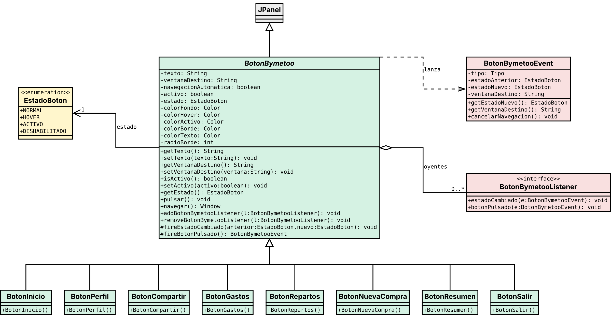
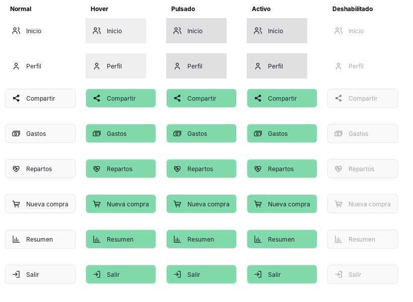

# Memoria del Proyecto – By Me Too · Sprint 3

26/11/2026

**Módulo:** Desarrollo de Interfaces (0488) · **Resultado de aprendizaje:** RA3, «Crea componentes visuales valorando y empleando herramientas específicas»\
**Proyecto:** By Me Too! / Cómprame! · **Equipo Nº 1**\
**Sprint:** Sprint 3, «Modularidad y Componentes Propios». Periodo del SOW: 02/11/2026 – 20/11/2026. El trabajo en el repositorio va del 17/11 al 26/11 y la defensa es el 30/11\
**Roles:** Roberto Heredia Chaves (Scrum Master / Lead Developer) · Elías Pérez Arroyo (Frontend UI/UX) · Siarhei Lukashou (QA Tester) · Pablo Azogue Castaño (Release Manager)\
**Repositorio:** [Diseno\_Interfaces-By-Me-Too](https://github.com/siarheilukashou25-maker/Diseno_Interfaces-By-Me-Too) · **Tablero:** [Project By Me Too!](https://github.com/users/siarheilukashou25-maker/projects/1)

---

## 1. Introducción

### 1.1. Punto de partida

En el Sprint 2 se cambió el enfoque a una aplicación de escritorio en Java Swing, diseñada con Matisse en Apache NetBeans. Se maquetaron las pantallas principales: `LoginView`, `MainView`, `UserView`, `GroupView`, `RepartosView`, `CompraWindow` y `ResumenView`.

Al revisar esas pantallas, los botones de navegación se repetían en casi todas: Inicio, Perfil, Gastos, Repartos, Nueva compra, Resumen, Compartir y Salir. Cada copia era un `JButton` con su color, su icono y su listener puestos a mano. Cambiar el aspecto obligaba a tocar todas las ventanas.

### 1.2. Objetivo del Sprint 3

Convertir esa navegación en un **componente visual propio y reutilizable** que cumpla el estándar JavaBeans. Además, había que probarlo, documentarlo, empaquetarlo en un `.jar` e instalarlo en la paleta de NetBeans para usarlo desde Matisse.

Resultado: la librería **`BymetooBotones.jar`**, con una clase base y **8 botones** que cambian de ventana solos al pulsarlos.

### 1.3. Relación con el RA3

| Criterio | Qué pide (RD 405/2023) | Dónde se trabaja en esta memoria | Estado |
| --- | --- | --- | --- |
| a | Se han identificado las herramientas para diseño y prueba de componentes | Apartados 3 y 6 | Cumplido |
| b | Se han creado componentes visuales | Apartado 4 | Cumplido |
| c | Se han definido sus métodos y propiedades con asignación de valores por defecto | Apartado 4.3 | Cumplido |
| d | Se han determinado los eventos y se les han asociado las acciones | Apartados 4.5 y 4.6 | Cumplido |
| e | Se han realizado pruebas unitarias sobre los componentes | Apartado 6 | Cumplido |
| f | Se han documentado los componentes creados | Apartado 7 | Cumplido |
| g | Se han empaquetado componentes | Apartado 5 | Cumplido |
| h | Se han programado aplicaciones cuyo interfaz gráfico utiliza los componentes creados | Apartado 5.4 | Cumplido (apartado 5.4, PR #222) |

---

## 2. Planificación del sprint

El backlog está en el [Project By Me Too!](https://github.com/users/siarheilukashou25-maker/projects/1). Las tareas de Desarrollo de Interfaces llevan el prefijo **DI-3.x**.

### 2.1. Roles del equipo

El rol de Scrum Master rota respecto a los Sprints 1 y 2. En este sprint lo asume el perfil de Backend, como pide el SOW.

| Rol | Miembro | Trabajo en el Sprint 3 |
| --- | --- | --- |
| Scrum Master / Lead Developer | Roberto Heredia Chaves | Arquitectura y clase del componente, evento propio, navegación, `.jar` y versionado en GitHub |
| Frontend (UI/UX) | Elías Pérez Arroyo | Feedback visual de los estados, colores y vista previa de los botones |
| QA Tester | Siarhei Lukashou | Plan de pruebas, casos de interacción, tests JUnit y de interfaz, rendimiento, seguridad y plan de integración |
| Release Manager | Pablo Azogue Castaño | Base técnica, versionado SemVer, herramienta de instalador y reorganización del repositorio |

### 2.2. Historias de usuario y tareas

| HU | Historia de usuario | Tarea del SOW | Dónde está en el repositorio | Estado |
| --- | --- | --- | --- | --- |
| HU-3.1 | Programar un control visual propio con propiedades por defecto y métodos (CE a, b, c) | T-3.1.1: jerarquía de la clase extendiendo `JPanel`, con color y tamaño | `BotonBymetoo` y los 8 botones | Hecho |
| HU-3.2 | Que el componente responda a eventos propios (CE d) | T-3.2.1: EventHandlers para las interacciones | `BotonBymetooEvent`, listener, adapter y manejo de ratón y teclado | Hecho |
| HU-3.3 | Probar el componente de forma aislada (CE e) | T-3.3.1: caso de prueba JUnit del cambio de estado | 144 tests en `componentes/test/` | Hecho |
| HU-3.4 | Documentar y empaquetar el componente en un `.jar` (CE f, g) | T-3.4.1: exportar a `.jar` y generar el Javadoc | `BymetooBotones.jar` y Javadoc sin errores | Hecho |
| HU-3.5 | Integrar el componente en el proyecto transversal (CE h) | T-3.5.1: importar el `.jar` y usar el componente en una vista | 29 botones en 6 ventanas, en `main` desde el PR #222 (apartado 5.4) | Hecho |

### 2.3. Desglose interno de tareas

| Tarea | Descripción | Responsable | Issue / PR | Estado |
| --- | --- | --- | --- | --- |
| DI-3.1 | Base técnica, versionado y reorganización del repositorio | Pablo | PR #206, #207 | Hecho |
| DI-3.1.1 | Clase del componente y los 8 botones | Roberto | PR #195 | Hecho |
| DI-3.1.2 | Bocetos y propiedades (estados y estilos) | Roberto / Elías | PR #195 | Hecho |
| DI-3.1.3 | Plan de pruebas del componente | Siarhei | #133 | Hecho |
| DI-3.1.8 | Arquitectura y diagrama de clases UML | Roberto | — | Hecho |
| DI-3.2.1 | Feedback visual de cada estado (`paintComponent`) | Elías | — | Hecho |
| DI-3.2.2 | Evento propio y listener | Roberto | #152 | Hecho |
| DI-3.2.3 | Casos de prueba de interacción | Siarhei | #135 | Hecho |
| DI-3.3.1 | Tests unitarios con JUnit | Siarhei | #137 | Hecho |
| DI-3.3.5 | Tests de interfaz con clics reales | Siarhei | #138 | Hecho |
| DI-3.3.6 | Registro y verificación de errores | Siarhei | #139 | Hecho |
| DI-3.4.3 | Generación del `.jar` y del Javadoc | Roberto / Siarhei | #141 | Hecho |
| DI-3.4.5 | Uso de recursos | Siarhei | #142 | Hecho |
| DI-3.4.6 | Plan y pruebas de integración | Siarhei | #144 | Hecho (salvo INT-02 e INT-05) |
| DI-3.5.4 | Integración de los botones en las vistas de la app | Elías | #115, PR #222 | Hecho |
| DI-3.5.6 | Seguridad básica | Siarhei | #145 | Hecho |
| — | Manual técnico, ayuda contextual e instalador | Pablo | PR #216, #218 | Hecho (falta el GUID) |
| — | Informe final de QA | Siarhei | #146 | Hecho |

Los responsables y números de PR salen del historial de Git. Las tareas marcadas con «—» no tienen un número de issue citado en el repositorio.

### 2.4. Cronología y sesiones

Según el SOW, el sprint se trabajó en las sesiones de Desarrollo de Interfaces: lunes de 14:00 a 14:55, miércoles y jueves de 12:00 a 12:55 y viernes de 11:00 a 12:55, del 02/11 al 20/11. El trabajo que se ve en el repositorio va del 17/11 al 26/11. Cronología según el historial de Git:

- **17/11:** primer diseño UML del componente.
- **20/11:** plan de pruebas v1 y casos de interacción v1.
- **22/11:** los 8 botones con cambio de ventana y la primera versión del feedback visual.
- **24/11:** plan de pruebas v2 y primera batería de tests JUnit (99 tests).
- **25/11:** corrección de los errores #188–#190 (PR #195), recuperación de los tests (PR #197), seguridad, tests de interfaz, plan de integración y reorganización de carpetas.
- **26/11:** ruta relativa del `.jar`, manual técnico, ayuda contextual e instalador, integración de los botones en la app (PR #222), corrección del hallazgo H-1 (PR #221) e informe final de QA con 144/144 tests.

### 2.5. T-3.0 · Preparación del repositorio

#### Protección de la rama `main`

- **El push directo a `main` está bloqueado.** Todo cambio entra mediante un Pull Request desde una rama propia.
- **Las aprobaciones no son obligatorias.** El PR se puede fusionar sin revisión.
- **Los revisores son opcionales.** El autor puede asignar uno si quiere una segunda opinión, sobre todo en cambios grandes o delicados.

No se exigen aprobaciones porque el equipo es pequeño y los sprints son cortos. Pedir una aprobación en cada PR bloquearía el trabajo hasta que alguien estuviera disponible. Bloquear el push directo ya garantiza que cada cambio quede registrado en un PR, con su historial y la posibilidad de revisarlo.

Flujo de trabajo:

1. Cada miembro trabaja en su rama (`roberto-branch`, `elias-branch`, `siarhei-branch`, `pablo-branch`), creada desde `main`.
2. Hace commits y sube la rama.
3. Abre un Pull Request hacia `main` y asigna revisor si lo considera necesario.
4. Fusiona el PR.

#### Integración continua (CI)

De momento no se configura CI, por tres motivos:

- El proyecto está en una fase inicial. La estructura y los componentes cambian a menudo, y mantener un pipeline ahora supondría más trabajo que beneficio.
- Al empezar el sprint había pocos tests automatizados, así que el pipeline apenas tendría nada que comprobar.
- Las comprobaciones se hacen en local antes de abrir el PR: *Clean and Build* y *Test Project* en NetBeans.

Cuando el código esté más estable se valorará añadir GitHub Actions para compilar y lanzar los tests en cada PR. La experiencia del sprint lo justifica: el PR #195 borró la carpeta de tests sin que nadie lo viera al fusionar, y un pipeline lo habría detectado (apartado 8.2).

---

## 3. Herramientas utilizadas (CE a)

| Herramienta | Uso en el sprint |
| --- | --- |
| Java 25 (JDK 26 en los equipos) | Lenguaje del componente. Se usan funciones nuevas: `import module`, clases `sealed`, código antes de `super()`, *pattern matching* y variable `_` |
| Apache NetBeans (proyecto Ant) | Edición, *Clean and Build*, Javadoc y ejecución de tests |
| Matisse (Form Editor) | Diseño de las vistas y prueba del componente desde la paleta |
| Palette Manager | Instalación de los 8 botones desde el `.jar` |
| JUnit 5 + runner de JUnit 4 | Tests unitarios. NetBeans con Ant solo lanza JUnit 4, así que cada clase usa `@RunWith(JUnitPlatform.class)` |
| AssertJ Swing | Tests con ratón y teclado reales sobre un `JFrame` |
| VisualVM 2.2.2 | Medición de memoria y fugas |
| Dia | Diagrama de clases (`componentes/docs/diagrama-clases.dia`) |
| Git y GitHub | Una rama por integrante, PRs a `main` y tablero Project |

Las tareas DI-3.3 y DI-3.3.5 nombraban TestFX. TestFX solo sirve para JavaFX y el componente es Swing, así que se usó **AssertJ Swing**, que ofrece lo mismo: robot, *fixtures* y comprobaciones sobre componentes.

---

## 4. Diseño e implementación del componente (CE b, c, d)

### 4.1. Arquitectura y diagrama de clases

```text
JPanel
  └── BotonBymetoo  (abstract sealed, Serializable)
        ├── BotonInicio        ├── BotonRepartos
        ├── BotonPerfil        ├── BotonNuevaCompra
        ├── BotonCompartir     ├── BotonResumen
        ├── BotonGastos        └── BotonSalir

BotonBymetoo ──> EstadoBoton    (NORMAL, HOVER, ACTIVO, DESHABILITADO)
BotonBymetoo ──> EstiloBoton    (MENU, CONTORNO_SUAVE, CONTORNO)
BotonBymetoo ──> TipoIcono + IconoNavegacion (icono dibujado con Java2D)
BotonBymetoo ..> BotonBymetooEvent  (lanza)
BotonBymetoo o── 0..* BotonBymetooListener  (BotonBymetooAdapter lo implementa vacío)
BeanInfoBotonBase ──> 8 clases Boton*BeanInfo
```

Diagrama UML completo (`componentes/docs/diagrama-clases.png`; versión en texto en `docs/Sprints/Sprint3/DI-3.1.8 Arquitectura y diagrama de clases.md`):



Decisiones de diseño:

- **Una clase padre y 8 hijas.** Todo lo común (propiedades, estados, pintado, eventos y navegación) está en `BotonBymetoo`. Cada hija solo pasa al constructor su texto, icono, estilo y ventana de destino. Un cambio de diseño se hace una vez.
- **`sealed` + `permits`.** Solo los 8 botones de la app pueden heredar de la clase padre. Por eso las hijas son `final`.
- **Hereda de `JPanel` y no de `JButton`.** Así el pintado de los cuatro estados y de los tres estilos queda bajo control del componente y no depende del *Look and Feel* Nimbus.

| Botón | Estilo | Ventana por defecto |
| --- | --- | --- |
| `BotonInicio` | MENU | `vista.MainView` |
| `BotonPerfil` | MENU | `vista.UserView` |
| `BotonCompartir` | CONTORNO\_SUAVE | `vista.GroupView` |
| `BotonGastos` | CONTORNO\_SUAVE | `vista.GroupView` (antes `vista.MainView`, corregido en H-1) |
| `BotonRepartos` | CONTORNO | `vista.RepartosView` |
| `BotonNuevaCompra` | CONTORNO | `vista.CompraWindow` |
| `BotonResumen` | CONTORNO | `vista.ResumenView` |
| `BotonSalir` | CONTORNO | `vista.LoginView` |

### 4.2. Cumplimiento del estándar JavaBeans

| Requisito | Cómo se cumple |
| --- | --- |
| Constructor público sin parámetros | Cada botón tiene `public BotonInicio()`, etc. La clase padre tiene un constructor `protected` con los cuatro datos |
| Serializable | `BotonBymetoo implements Serializable` con `serialVersionUID`. Las clases internas del ratón y del teclado también son serializables |
| Getters / setters | `getTexto`/`setTexto`, `isActivo`/`setActivo`, `getColorFondo`/`setColorFondo`… |
| Propiedades enlazadas (*bound*) | Cada setter avisa con `PropertyChangeSupport.firePropertyChange(...)`. Los nombres son constantes: `PROP_TEXTO`, `PROP_ACTIVO`, `PROP_ESTADO`… |
| Introspección controlada | Un `BeanInfo` por botón (apartado 5.1) |

### 4.3. Propiedades y valores por defecto (CE c)

| Propiedad | Tipo | Valor por defecto | En la paleta |
| --- | --- | --- | --- |
| `texto` | String | El nombre del botón | Preferente |
| `ventanaDestino` | String | Ver tabla 4.1 | Preferente |
| `navegacionAutomatica` | boolean | `true` | Preferente |
| `cerrarVentanaActual` | boolean | `true` | Preferente |
| `activo` | boolean | `false` | Sí |
| `iconoPersonalizado` | Icon | `null` (usa el icono dibujado) | Sí |
| `colorFondo` | Color | `#FAFAFA` | Sí |
| `colorHover` | Color | Menú: `rgba(26,32,44,0.08)`. Resto: verde `#81DAAB` | Sí |
| `colorActivo` | Color | Menú: `rgba(26,32,44,0.14)`. Resto: verde `#81DAAB` | Sí |
| `colorBorde` / `colorBordeHover` | Color | `#E2E8E5` | Sí |
| `colorTexto` | Color | `#1A202C` | Sí |
| `colorTextoDeshabilitado` | Color | `#1A202C` con alpha 100 | Sí |
| `radioBorde` | int | 6 | Sí |
| `separacionIcono` | int | 12 | Sí |
| `estado`, `tipoIcono`, `estilo` | enum | Calculados | Solo lectura |

Tamaño preferido: 120×50 px en el estilo MENU y 140×38 px en los estilos con contorno.

Los valores inválidos no rompen el componente: un `null` en `texto` o `ventanaDestino` se guarda como cadena vacía, y los tests L-01…L-18 cubren negativos, textos largos y emojis.

### 4.4. Estados y feedback visual

El estado se calcula siempre con la misma prioridad:

```text
¿deshabilitado? → DESHABILITADO
¿activo?        → ACTIVO   (es la pantalla en la que estás)
¿ratón encima?  → HOVER
si no           → NORMAL
```

Cuando cambia, el botón se repinta, lanza un `PropertyChangeEvent` de `estado` y un `BotonBymetooEvent` de tipo `CAMBIO_ESTADO`. `paintComponent` dibuja el fondo redondeado y el borde según el estilo. El icono (`IconoNavegacion`) se dibuja con Java2D en el color del texto, así que se atenúa solo cuando el botón está deshabilitado. El cursor pasa a mano si el botón está habilitado.

El botón también responde al teclado: con el foco puesto, **Espacio** o **Intro** lo pulsan.

#### Validación visual y accesibilidad por teclado

La ejecución de la app (capturas del apartado 5.4) demuestra que la paleta y la jerarquía visual de los botones de Bymetoo son coherentes en toda la interfaz, tal como se planeó en el Sprint 2. Se distinguen claramente los botones de navegación global (estilo MENU: Inicio y Perfil) y las acciones dentro del grupo (estilos con contorno: Gastos, Repartos, Nueva compra, Resumen, Compartir y Salir). Además de cumplir las pautas de contraste y legibilidad, se ha reforzado la usabilidad con un indicador de foco muy visible y con navegación completa por teclado.

**Indicador visual de foco (2 px en `#1A202C`).** Para que el usuario sepa en todo momento qué botón está seleccionado cuando se mueve sin ratón, el botón dibuja un borde de foco propio cuando lo recibe (`hasFocus()`). El contorno mide 2 px, usa el color oscuro corporativo `#1A202C` y respeta la forma del botón: esquinas redondeadas (arco de 12 px, es decir, `radioBorde` 6) en los botones de grupo y esquinas rectas en los de menú. Gracias al alto contraste con el fondo claro (`#FAFAFA`), el foco se ve sin dudas, incluso para personas con baja visión. En la captura de la pantalla de grupos se ve en el botón Perfil.

**Interacción completa con el teclado (Tab, Intro y Espacio):**

- **Desplazamiento con Tab y Mayús + Tab.** Con `setFocusable(true)`, los botones entran en el ciclo de tabulación de la ventana. El usuario avanza o retrocede por la barra superior y por la zona del grupo en un orden lógico y predecible. Los botones deshabilitados se saltan automáticamente.
- **Activación con Intro y Espacio.** Las dos teclas están asociadas a la acción de pulsar en el `InputMap` y el `ActionMap` del componente (`WHEN_FOCUSED`). Al pulsarlas sobre el botón con foco se lanza exactamente el mismo flujo que con un clic: evento `botonPulsado`, estado `ACTIVO` (verde `#81DAAB` en los botones de grupo y tinte gris en los de menú) y cambio de ventana. Así, la aplicación se puede manejar al 100 % con el teclado.

Esto se comprobó con los tests de interfaz G-01…G-10 (apartado 6.2), que incluyen Tab, Espacio e Intro con un robot de teclado real.

**\[COMPLETAR: el borde de foco de 2 px todavía no está en el código de GitHub. Hay que subirlo junto con las vistas\]**

Estados del componente (`componentes/docs/estados-componente.png`):



### 4.5. Eventos (CE d)

El componente define su propio evento siguiendo el patrón de Swing: evento, listener y adapter.

| Clase | Función |
| --- | --- |
| `BotonBymetooEvent extends EventObject` | Dos tipos: `CAMBIO_ESTADO` y `PULSADO`. Lleva el estado anterior, el nuevo y la ventana de destino |
| `BotonBymetooListener extends EventListener` | `estadoCambiado(e)` y `botonPulsado(e)` |
| `BotonBymetooAdapter` | Implementación vacía para sobrescribir solo un método, como `MouseAdapter` |

`botonPulsado` se lanza **antes** de cambiar de ventana. Si el listener llama a `e.cancelarNavegacion()`, el botón no navega. Es útil, por ejemplo, para confirmar la salida:

```java
botonSalir1.addBotonBymetooListener(new BotonBymetooAdapter() {
    @Override
    public void botonPulsado(BotonBymetooEvent e) {
        int r = JOptionPane.showConfirmDialog(null, "¿Seguro que quieres salir?");
        if (r != JOptionPane.YES_OPTION) {
            e.cancelarNavegacion();
        }
    }
});
```

En Matisse el evento aparece en *Events → botonBymetoo → botonPulsado*. Al hacer doble clic sobre el botón en el diseñador, NetBeans crea directamente ese manejador, porque `getDefaultEventIndex()` devuelve 0.

### 4.6. Navegación entre ventanas

Al pulsar (`pulsar()`):

1. El botón se marca como activo y lanza `botonPulsado`.
2. Si `navegacionAutomatica` es `true` y nadie canceló, llama a `navegar()`.
3. `navegar()` crea la ventana de destino por reflexión, la centra sobre la actual, la muestra y cierra la anterior si `cerrarVentanaActual` es `true`.
4. Si ya estás en la ventana de destino, no abre otra copia.
5. Si el destino es un `JDialog` modal, no cierra la ventana de detrás, para que la app no se quede sin ventanas al cerrar el diálogo.

Al añadirse a una ventana (`addNotify()`), el botón se pone activo solo si esa ventana es su destino. Si la clase de destino no existe, se deshabilita con el *tooltip* «Pantalla no disponible». En el diseñador de NetBeans (`Beans.isDesignTime()`) no hace nada de esto, para no romper la vista de diseño.

Si algo falla al abrir la ventana, se muestra un aviso con el motivo real (clase no encontrada, no es una ventana, sin constructor vacío o error dentro del constructor) y se escribe la traza en la consola.

### 4.7. Ayuda contextual (F1)

La clase de utilidad `AyudaContextual` añade ayuda sensible al contexto a cualquier componente Swing. Con `AyudaContextual.instalar(componente, titulo, mensaje)` se asocia la tecla **F1** al componente: cuando tiene el foco y se pulsa F1, aparece un diálogo informativo con el título y el mensaje indicados. Comprueba que ningún parámetro sea `null` y no se puede instanciar, porque solo tiene métodos estáticos.

```java
AyudaContextual.instalar(botonRepartos1, "Repartos",
        "Muestra cuánto debe pagar cada miembro del grupo.");
```

La clase está incluida en el `.jar` regenerado del 26/11, pero las vistas de la app todavía no la llaman y no tiene tests propios. Queda como utilidad disponible para el siguiente sprint.

---

## 5. Integración en NetBeans y empaquetado (CE g)

### 5.1. BeanInfo

`BeanInfoBotonBase extends SimpleBeanInfo` concentra lo común y cada botón tiene su `Boton*BeanInfo` de 3 líneas. Sirve para:

- **Limpiar la hoja de propiedades.** Solo se muestran las propiedades del botón y cuatro heredadas útiles (`enabled`, `font`, `toolTipText` y `preferredSize`), en lugar de las decenas que trae `JPanel`. Las cuatro principales están marcadas como preferentes.
- **Publicar el evento propio** en la pestaña *Events*, junto con `propertyChange`.
- **Poner nombre, descripción e icono en la paleta.** Iconos PNG de 16×16 y 32×32 en `componentes/src/iconos/`.

### 5.2. Manifiesto y `.jar`

`componentes/manifest.mf` declara los 8 botones como JavaBeans:

```text
Name: com/bymetoo/componentes/BotonInicio.class
Java-Bean: True
(… lo mismo para los otros 7 botones)
```

El `.jar` se genera con *Clean and Build* en NetBeans y sale en `componentes/dist/BymetooBotones.jar`. Una copia está en `ByMeToo/Jar/BymetooBotones.jar`. La app lo enlaza con **ruta relativa** (`file.reference.BymetooBotones.jar=Jar/BymetooBotones.jar`), así compila en cualquier PC. Antes estaba con una ruta absoluta de un equipo concreto y se corrigió el 25-26/11.

El `.jar` está compilado con Java 25: la app necesita JDK 25 o superior.

### 5.3. Instalación en la paleta de Matisse

1. En el proyecto de la app: *Libraries → Add JAR/Folder* → `Jar/BymetooBotones.jar`.
2. *Tools → Palette → Swing/AWT Components → Add from JAR…* → elegir el `.jar` → marcar los 8 botones → categoría «Bymetoo».
3. Arrastrar los botones a las vistas en modo *Design*. Matisse escribe su creación dentro de `initComponents()`, en el bloque protegido, y la guarda en el `.form`.
4. Cambiar `ventanaDestino` o los colores desde *Properties* si hace falta.

**\[COMPLETAR: captura de la paleta con la categoría «Bymetoo» y de la hoja de propiedades\]**

### 5.4. Integración en la aplicación principal (CE h, HU-3.5)

Los botones de navegación de las vistas de `ByMeToo` se han sustituido por los componentes de `BymetooBotones.jar` (tarea #115). El trabajo se hizo en `elias-branch` y entró en `main` el 26/11 con el PR #222. El `.jar` de `ByMeToo/Jar/` se volvió a generar con el arreglo de Gastos y con `AyudaContextual`. En total hay **29 botones en 6 ventanas**:

| Ventana | Botones Bymetoo | N.º | Activo |
| --- | --- | --: | --- |
| `MainView` (grupos) | Inicio, Perfil | 2 | Inicio ✔ |
| `UserView` (perfil) | Inicio, Perfil, Salir | 3 | Perfil ✔ |
| `GroupView` (gastos del grupo) | Inicio, Perfil, Gastos, Repartos, Nueva compra, Resumen | 6 | Gastos ✔ |
| `RepartosView` | Inicio, Perfil, Gastos, Repartos, Nueva compra, Resumen | 6 | Repartos ✔ |
| `CompraWindow` | Inicio, Perfil, Gastos, Repartos, Nueva compra, Resumen | 6 | Nueva compra ✔ |
| `ResumenView` | Inicio, Perfil, Gastos, Repartos, Nueva compra, Resumen | 6 | Resumen ✔ |
| `LoginView` | Ninguno (sus botones no son de navegación) | 0 | — |

Cada vista registra un `BotonBymetooListener` en sus botones desde el código generado por Matisse. Las capturas de QA de las seis ventanas están en `docs/qa/integracion/`. Abajo van las capturas de la app ejecutándose:

Los botones de acción (Añadir, Editar, Pagado, Crear grupo…) siguen siendo `JButton`.

**Pantalla de grupos (`MainView`).** En la barra superior, `BotonInicio` está activo (fondo verde) y `BotonPerfil` tiene el foco de teclado (borde oscuro). Los botones «Compartir» y «Salir» de cada tarjeta de grupo, así como Crear grupo, Unirse y Hacer compra, siguen siendo `JButton`.


**Pantalla de perfil (`UserView`).** `BotonPerfil` está activo porque es su ventana de destino, y `BotonSalir` aparece abajo a la derecha.


**Pantalla de resumen (`ResumenView`).** Debajo del menú (Inicio, Perfil) está la barra del grupo con los botones de estilo contorno: Gastos, Repartos, Nueva compra y Resumen, con **Resumen activo en verde**. Los botones «Pagar con Bizum» siguen siendo `JButton`.


**Pantalla de compra (`CompraWindow`).** En la barra del grupo, **Nueva compra está activo** en verde. Con el ratón encima sale su *tooltip*, «Añadir una compra nueva», una propiedad heredada que el `BeanInfo` deja visible en la paleta. Los botones de acción (Volver, Añadir, Editar, Eliminar, Reasignar, Marcar pagado y Editar reparto) siguen siendo `JButton`. El botón «Repartos» que se ve suelto sobre la tabla es un `JButton` antiguo que se quedó sin usar (`jButton7`, observación de QA). Hay que borrarlo en Matisse.


Con esto se cumple el criterio h: la interfaz de la aplicación principal usa el componente creado en este sprint, y el código está en `main`. Los resultados de las pruebas de integración están en el apartado 6.7.

### 5.5. `module-info.java` y dependencias

**Decisión: el proyecto no usa `module-info.java`.** Los dos proyectos, `componentes` y `ByMeToo`, trabajan con el *classpath* de NetBeans (Ant) y no con el sistema de módulos de Java. La tarea #159 se cerró con esta decisión, sin añadir el archivo.

Motivos:

- **El componente no necesita dependencias externas para funcionar.** Solo usa el JDK (`java.desktop`: Swing, AWT y `java.beans`), así que no hay paquetes que exponer ni módulos de terceros que declarar. En `componentes/nbproject/project.properties`, `javac.classpath` está vacío.
- **Java 25 ya permite importar el módulo completo sin `module-info`.** El código usa `import module java.desktop;`, que funciona aunque el proyecto no sea modular.
- **El problema que resuelve `module-info` en el SOW es de JavaFX.** El impedimento de ejemplo del SOW (no poder exportar el `.jar` por las dependencias gráficas de JavaFX) no se da con Swing, que viene incluido en el JDK.
- **Riesgo con los tests.** Al añadir `module-info`, NetBeans pasa el proyecto a *modulepath*. Las librerías de prueba (JUnit 5, el runner de JUnit 4 y AssertJ Swing) no son módulos con nombre y habría que reconfigurar la ejecución de los 144 tests justo antes de la entrega.

Cómo quedan las dependencias:

| Proyecto | Dependencias | Para qué |
| --- | --- | --- |
| `componentes` (ejecución) | Ninguna fuera del JDK | El `.jar` funciona solo |
| `componentes` (tests) | `lib/junit-platform-console-standalone-1.11.4.jar`, `lib/junit-platform-runner-1.11.4.jar`, `lib/junit-4.13.2.jar`, `lib/hamcrest-core-1.3.jar`, `lib/assertj-swing-3.17.1.jar`, `lib/assertj-core-3.26.3.jar` | JUnit 5 lanzado desde NetBeans y clics reales con AssertJ Swing |
| `ByMeToo` | `Jar/BymetooBotones.jar` (ruta relativa) | Usar los 8 botones en las vistas |

Los dos proyectos compilan con `javac.source=25` y `javac.target=25`, así que hace falta JDK 25 o superior.

Si en un sprint futuro el proyecto pasa a ser modular, el descriptor del componente sería este:

```java
module com.bymetoo.componentes {
    requires java.desktop;
    exports com.bymetoo.componentes;
}
```

### 5.6. Instalador para Windows

El Release Manager preparó un script de **Inno Setup** (`componentes/instalador-Windows/BymetooBotones.iss`) que genera `Instalador-BymetooBotones-v1.0.exe`. El asistente instala en `Archivos de programa\BymetooBotones` el `.jar`, el `README.md` y el manual técnico (`docs/Manual-tecnico.md`), con compresión LZMA, estilo de asistente moderno y opción de desinstalar. La versión 1.0 sigue el esquema SemVer de la base técnica.

**\[COMPLETAR: el `AppId` del script todavía es un marcador (`GENERAR-GUID-PARA-ESTA-APLICACION`). Hay que generar un GUID en Inno Setup (*Tools → Generate GUID*) antes de compilar el instalador definitivo, y añadir una captura del asistente\]**

### 5.7. Distribución y versionado (GitHub Releases)

La biblioteca se distribuye con **GitHub Releases**, separada de la aplicación: el archivo publicado contiene solo los componentes gráficos, no la app ByMeToo completa.

| Elemento | Valor |
| --- | --- |
| Nombre | BymetooBotones |
| Versión | `v1.0` (etiqueta Git sobre el commit `24e79c4`) |
| Título | BymetooBotones v1.0 – Primera versión estable |
| Archivos | `BymetooBotones.jar` y el Javadoc comprimido |

Publicar con Releases deja un historial de versiones, permite descargar una versión concreta y saber cuál se está usando, y reparte solo lo necesario sin los archivos internos del proyecto.

Otro proyecto que quiera usar los botones solo necesita tres pasos: descargar el `.jar` del Release (o tomarlo de `componentes/dist/`), añadirlo en *Project Properties → Libraries* e importar las clases de `com.bymetoo.componentes`. Si además quiere usarlos desde el diseñador, los añade a la paleta como en el apartado 5.3.

**Ojo con la versión:** la etiqueta `v1.0` es anterior a la corrección del hallazgo H-1 (PR #221), así que en ese `.jar` `BotonGastos` todavía lleva a `vista.MainView`. Siguiendo SemVer, la corrección debería publicarse como `v1.0.1` (un parche). **\[COMPLETAR: publicar el Release `v1.0.1` con el `.jar` actual, o volver a generar los archivos de `v1.0`\]**

---

## 6. Pruebas (CE a, e)

### 6.1. Plan de pruebas

El plan (`docs/qa/plan-pruebas.md`, v2 del 24/11) prueba un botón de cada estilo a fondo (Inicio, Compartir y Salir). Los 8 se prueban con tests parametrizados para los valores por defecto. Todos los accesos a Swing se hacen en el EDT (`SwingUtilities.invokeAndWait`). Los colores se comprueban pintando el botón en una `BufferedImage` y leyendo píxeles, lo que funciona también sin pantalla.

Los 38 casos de interacción (`docs/qa/casos-interaccion.md`, v3) describen qué eventos deben llegar, y cuántas veces, en cada acción: entrar y salir con el ratón, clic, teclado, deshabilitado, cancelación, etc.

### 6.2. DI-3.3 · Pruebas unitarias del componente (CE e)

#### Primera batería de tests JUnit 5 (DI-3.3.1, #137)

Se escribieron **99 tests JUnit 5** en `test/com/bymetoo/componentes/`. Al principio estaban en la carpeta `BymetooBotones/`, que el 25/11 se renombró a `componentes/`.

| Clase | Qué prueba |
| --- | --- |
| `BotonBymetooValoresTest` | Valores por defecto de los 8 botones, getters y setters, valores inválidos |
| `BotonBymetooEstadosTest` | Lógica de estados y colores pintados |
| `BotonBymetooEventosTest` | `estadoCambiado`, `botonPulsado`, cancelación y `PropertyChangeEvent` |
| `BotonBymetooNavegacionTest` | Apertura y cierre de ventanas |
| `BotonBymetooHallazgosTest` | Requisitos de diseño que en ese momento no se cumplían |

**Resultado (24/11, NetBeans con JDK 26):** 118 ejecuciones, 115 pasan y 3 fallan. NetBeans cuenta 118 porque suma cada grupo de tests parametrizados. Los 3 fallos eran errores reales del componente y se registraron en DI-3.3.6 (#139). El detalle está en [resultados-DI-3.3.1.md](https://github.com/siarheilukashou25-maker/Diseno_Interfaces-By-Me-Too/blob/siarhei-branch/docs/qa/resultados-DI-3.3.1.md).

Para ejecutarlos: abrir el proyecto del componente en NetBeans → *Run → Test Project* (Alt+F6).

Criterios de la tarea:

- [x] Valores por defecto
- [x] Getters y setters
- [x] Rechazo de valores inválidos
- [x] Disparo de eventos
- [x] Tests ejecutados y resultado guardado en el repositorio

#### Tests de interfaz con clics reales (DI-3.3.5, #138) · hecho el 25/11

TestFX solo funciona con JavaFX y el componente es Swing, así que se usó **AssertJ Swing**. El enfoque es el mismo: un robot mueve el ratón y pulsa teclas de verdad sobre una ventana. Librerías: `lib/assertj-swing-3.17.1.jar` y `lib/assertj-core-3.26.3.jar`.

`BotonBymetooGuiTest` tiene 10 casos, del G-01 al G-10:

- hover real con el ratón;
- clic izquierdo;
- clic derecho y central (no deben pulsar);
- Espacio e Intro;
- Tab para mover el foco;
- botón deshabilitado;
- pulsar y arrastrar fuera del botón;
- doble clic;
- navegación real entre ventanas;
- mantener pulsado.

**Resultado:** 10 de 10, en tres ejecuciones seguidas y sin fallos aleatorios. Sin pantalla (modo *headless*) estos tests se saltan solos.

Los errores que encontraron estas pruebas, cómo se corrigieron y los hallazgos de seguridad están en los apartados 6.4 y 6.5. El resultado final de todos los tests está en el 6.3.

### 6.3. Resultado final de todas las pruebas

Última ejecución completa documentada (25/11/2026, Windows, JDK 26.0.2, NetBeans):

| Clase de test | Qué prueba | Tests | Pasan |
| --- | --- | --: | --: |
| `BotonBymetooValoresTest` | Valores por defecto y propiedades | 51 | 51 |
| `BotonBymetooEstadosTest` | Estados y pintado | 29 | 29 |
| `BotonBymetooEventosTest` | Eventos y `PropertyChange` | 16 | 16 |
| `BotonBymetooNavegacionTest` | Navegación entre ventanas | 10 | 10 |
| `BotonBymetooHallazgosTest` | Regresión de #188–#190 | 3 | 3 |
| `BotonBymetooSeguridadTest` | Seguridad básica | 12 | 12 |
| `BotonBymetooGuiTest` | Clics reales con AssertJ Swing | 10 | 10 |
| `BotonBymetooInteraccionTest` | Casos de interacción pendientes | 13 | 13 |
| **Total** |  | **144** | **144** |

**Pasan los 144 tests.** Última ejecución completa: 26/11/2026 sobre `main` (commit `24e79c4`), en Windows con JDK 26.0.2 y NetBeans 31. Hubo una comprobación cruzada en Linux con JDK 21 y pantalla virtual. El 25/11 fallaban 2 (SEG-02 y SEG-04, a propósito hasta corregirlos), y con los arreglos del apartado 6.5 pasaron a estar en verde.

Veredicto del informe final de QA (#146): **el componente es apto**. Todos los errores registrados están corregidos y todos los tests pasan. `AyudaContextual`, añadida el 26/11, todavía no tiene tests propios.

NetBeans muestra un número mayor (por ejemplo, «220 passed») porque cuenta también cada grupo de tests parametrizados. El número real de tests es 144.

### 6.4. Errores encontrados y corregidos

| Issue | Error | Gravedad | Corregido en | Verificación |
| --- | --- | --- | --- | --- |
| #188 | En los estilos con contorno no se veía el hover | Media | PR #195: hover verde `#81DAAB` | Test O-1a |
| #189 | En el menú, HOVER y ACTIVO se pintaban igual | Media | PR #195: hover al 8 % y activo al 14 % de opacidad | Test O-1b |
| #190 | El texto deshabilitado era igual que el normal | Media | PR #195: `#1A202C` con alpha 100 | Test O-2 |
| #198 | `crearVentana()` ejecutaba el bloque `static` de clases que no son ventanas | Baja | Commit `299e12e` | Test SEG-02 |
| #199 | Un texto con `<html>` se interpretaba como HTML | Baja | Commit `299e12e` | Test SEG-04 |
| #200 | La app enlazaba el `.jar` con ruta absoluta | Alta | Commits `231b062`, `240d4d4` y `d2fb24f`: ruta relativa `Jar/BymetooBotones.jar` | Revisión de `project.properties` |
| H-1 | `BotonGastos` llevaba a Inicio (`vista.MainView`) y en `GroupView` no salía ningún botón activo | Media | PR #221: destino `vista.GroupView` | Prueba de integración 4/4 |
| — | El PR #195 borró la carpeta `test/` y las librerías | — | Recuperadas en el PR #197 | 144 tests de nuevo |

El registro completo está en la issue #139. **No queda ningún error abierto.**

Los tests O-1a, O-1b y O-2 se quedan como pruebas de regresión.

### 6.5. Seguridad

| Hallazgo | Riesgo | Arreglo aplicado |
| --- | --- | --- |
| SEG-02 | Al comprobar la ventana de destino se ejecutaba el bloque `static` de cualquier clase, aunque no fuese una ventana | `Class.forName(nombre, false, cargador)`: primero se comprueba que es una `Window` y solo después se crea |
| SEG-04 | Un texto que empezase por `<html>` se interpretaba como HTML (podía cambiar el aspecto o cargar imágenes externas) | `etiqueta.putClientProperty("html.disable", Boolean.TRUE)` |

### 6.6. Rendimiento

Medido con VisualVM en Windows y JDK 26.0.2:

| Escenario | Resultado | Criterio |
| --- | --- | --- |
| Crear 1.000 botones | 123 ms, unos 2,3 KB por botón | < 10 KB ✔ |
| 10.000 cambios de estado | unos 0,005 ms por cambio | < 1 ms ✔ |
| Abrir y cerrar 200 ventanas | 0,39 MB retenidos, el *heap* vuelve a su nivel | Sin fugas ✔ |
| Navegar 100 veces | 0,03 MB retenidos | Sin fugas ✔ |

### 6.7. Pruebas de integración

Se ejecutó el 26/11 con el programa `docs/qa/integracion/Integracion.java` (AssertJ Swing). El programa abre cada ventana de la app, busca todos los `BotonBymetoo`, anota su estado, hace **un clic real con el ratón en cada botón** y cuenta las ventanas abiertas. También prueba un doble clic por ventana. Los resultados completos y las capturas están en `docs/qa/integracion/resultados-integracion.md`.

| ID | Caso | Resultado |
| --- | --- | --- |
| INT-01 | La app compila con el componente | ✔ |
| INT-02 | Los botones se cargan en Matisse | ⏳ Comprobar en NetBeans (los `.form` ya usan los botones) |
| INT-03 | Texto, icono y estilo en cada ventana | ✔ 6 ventanas |
| INT-04 | Solo está activo el botón de la pantalla actual | ✔ 6/6 tras corregir H-1 |
| INT-05 | Cambiar el tamaño de la ventana | ⏳ Comprobar a mano |
| INT-06…INT-08 | Navegación entre ventanas | ✔ 29/29 clics abren la ventana correcta y cierran la anterior |
| INT-09 | Pulsar el botón de la pantalla actual | ✔ No abre otra copia (5/5) |
| INT-10 | Doble clic | ✔ Abre una sola ventana (6/6) |
| INT-11 | No se acumulan ventanas | ✔ Tras cada clic queda una sola ventana visible |
| INT-12 | Salir | ✔ En `UserView` abre `LoginView` |
| INT-13 | Cancelar la navegación desde la app | No aplica: la app no cancela nunca (listeners vacíos) |
| INT-14, INT-15 | Datos entre ventanas | No aplica todavía: las ventanas muestran datos de ejemplo |
| INT-16, INT-17 | Tab, Espacio e Intro | ✔ Los 29 botones reciben el foco |

En estas pruebas apareció el hallazgo H-1 (apartado 6.4), que se corrigió y se volvió a verificar el mismo día. **\[COMPLETAR: INT-02 e INT-05, comprobar en NetBeans\]**

---

## 7. Documentación (CE f)

- **Javadoc** de todas las clases públicas, con ejemplos de uso en `{@code}`. Generado desde NetBeans con **0 errores y 0 avisos**.
- **`componentes/README.md`:** qué hace cada botón, estructura del proyecto, cómo generar el `.jar`, cómo instalarlo en la paleta y cómo usar el evento.
- **Diagrama UML** en Dia, PNG y Mermaid, con leyenda.
- **Documentación de QA** en `docs/qa/`: plan de pruebas, casos de interacción, resultados, informe del 25/11, plan de integración e informe final.
- **Base técnica** en `docs/arquitectura/ArquitecturaTécnica.md`: estructura del repositorio, ramas y versionado SemVer.

#### Manual técnico

El Release Manager redactó el **manual técnico** (`componentes/docs/Manual-tecnico.md`), pensado para cualquier desarrollador que vaya a usar o mantener la biblioteca. Deja clara la diferencia entre **BymetooBotones**, la biblioteca de componentes, y **ByMeToo**, la aplicación que la usa. Tiene 17 apartados:

| Bloque | Contenido |
| --- | --- |
| Introducción y arquitectura (1–2) | Tecnologías (Java, Swing, Ant, NetBeans, JUnit, Javadoc), paquete `com.bymetoo.componentes`, clase base sellada y ventajas de la jerarquía |
| Referencia de la API (3–7) | Los 8 botones, todas las clases, los estados, estilos e iconos, y las 18 propiedades propias más las 4 heredadas que expone el `BeanInfo` |
| Eventos y navegación (8–11) | `estadoCambiado` y `botonPulsado`, registro de listeners, cancelación de la navegación con ejemplo de confirmación, `PropertyChange` y propiedades de navegación |
| Ayuda contextual (12) | `AyudaContextual.instalar` con F1, ejemplo y funcionamiento con `InputMap`, `ActionMap` y `KeyStroke` |
| Uso y construcción (13–15) | Integración en otro proyecto y en la paleta, *Clean and Build*, ubicación del `.jar` y del Javadoc (`componentes/dist/javadoc/index.html`) |
| Distribución y mantenimiento (16–17) | GitHub Releases `v1.0`, tabla de problemas frecuentes y recomendaciones de mantenimiento |

El instalador de Windows (apartado 5.6) copia el manual junto al `.jar`.

#### Resolución de problemas

Resumen de la tabla de problemas frecuentes del manual:

| Problema | Solución |
| --- | --- |
| No se reconoce el paquete `com.bymetoo.componentes` | Comprobar que `BymetooBotones.jar` está añadido a las bibliotecas del proyecto |
| Error de incompatibilidad de Java | Usar JDK 25 o superior, la versión con la que se compiló la biblioteca |
| No cambia de ventana | Revisar `ventanaDestino` y `navegacionAutomatica`, y comprobar si algún listener canceló la navegación |
| No llegan los eventos | Comprobar que el listener se registró con `addBotonBymetooListener` |
| No aparece la ayuda con F1 | Comprobar que el componente tiene el foco y que se llamó a `AyudaContextual.instalar` |
| No se genera el `.jar` | Revisar los errores de compilación y el resultado de los tests |

Recomendaciones de mantenimiento del manual: actualizar la documentación y regenerar el Javadoc cuando cambie la API, pasar los tests tras cada cambio, comprobar la integración en la app tras cambios importantes y publicar una versión nueva con cada corrección relevante.

---

## 8. Definition of Done e impedimentos

### 8.1. Definition of Done del Sprint 3

| Punto del DoD | Evidencia | Estado |
| --- | --- | --- |
| 1. Arquitectura del componente (CE a, b, c) | Clase que hereda de `JPanel`, atributos privados, getters y setters, valores por defecto (apartado 4) | ✔ |
| 2. Gestión de eventos (CE d) | Evento `BotonBymetooEvent` con `estadoCambiado` y `botonPulsado`, cancelable, y navegación asociada (apartados 4.5 y 4.6) | ✔ |
| 3. Aseguramiento de la calidad (CE e) | 144 tests unitarios, de interacción, de interfaz y de seguridad (apartado 6) | ✔ |
| 4. Empaquetado y distribución (CE f, g) | `BymetooBotones.jar` con manifiesto `Java-Bean: True` y Javadoc con 0 errores (apartados 5 y 7) | ✔ |
| 5. Integración final (CE h) | El `.jar` está enlazado en `ByMeToo` con ruta relativa y las pantallas usan los botones Bymetoo (capturas del apartado 5.4) | ✔ |

### 8.2. Registro de impedimentos (Scrum Master Log)

| Fecha | Impedimento | Impacto | Solución acordada | Estado |
| --- | --- | --- | --- | --- |
| 20/11 | El SOW pide TestFX, pero el componente es Swing y TestFX solo funciona con JavaFX | HU-3.3: no se podían automatizar los clics | Usar AssertJ Swing, que ofrece robot y *fixtures* para Swing | Resuelto |
| 24/11 | NetBeans con Ant solo ejecuta tests de JUnit 4 | HU-3.3: los tests de JUnit 5 no se lanzaban | `@RunWith(JUnitPlatform.class)` y los JAR de `lib/` | Resuelto |
| 24/11 | Tres errores de diseño: hover invisible en contorno (#188), hover igual a activo en el menú (#189) y texto deshabilitado igual al normal (#190) | HU-3.2: el feedback visual no cumplía el boceto | Nuevos colores en el PR #195 y tests de regresión | Resuelto |
| 25/11 | El PR #195 borró la carpeta `test/` y las librerías | HU-3.3: se perdían todos los tests | Recuperados en el PR #197 | Resuelto |
| 25/11 | La app enlazaba el `.jar` con una ruta absoluta de un PC concreto | HU-3.5: la app no compilaba en otros equipos | Ruta relativa `Jar/BymetooBotones.jar` | Resuelto |
| 25/11 | Seguridad: SEG-02 (bloques `static` de clases ajenas) y SEG-04 (texto HTML interpretado) | HU-3.3: 2 tests fallaban | `Class.forName(…, false, …)` y `html.disable` | Resuelto |
| 25/11 | Las vistas de la app usaban `JButton` normales en lugar del componente | HU-3.5 y DoD 5: no se cumple el CE h | Sustituir los botones de navegación por los botones Bymetoo (#115, PR #222) | Resuelto |
| 26/11 | H-1: BotonGastos llevaba a Inicio (vista.MainView) y en GroupView no salía ningún botón activo | HU-3.5: la navegación del grupo no era correcta | Destino vista.GroupView (PR #221) y .jar regenerado | Resuelto |

---

## 9. Valoración y problemas pendientes

### 9.1. Lo que ha funcionado

- Una sola clase base hace que los 8 botones sean coherentes y que el diseño se cambie en un único sitio.
- El evento cancelable permite añadir lógica (confirmar la salida, validar un formulario) sin tocar el componente.
- La batería de tests detectó tres errores de diseño antes de integrar el componente y también el borrado accidental de los tests en un PR.
- El `BeanInfo` hace que el componente se use en Matisse como uno estándar: hoja de propiedades limpia, evento propio e icono en la paleta.

### 9.2. Pendiente para el siguiente sprint

| Punto | Detalle |
| --- | --- |
| Botones «Compartir» y «Salir» | Siguen siendo `JButton` en `MainView`, `GroupView` y `CompraWindow`. Solo en `UserView` «Salir» es `BotonSalir` |
| `JButton` sin usar | Quedan botones «Repartos» antiguos en `GroupView` (`jButton3`) y `CompraWindow` (`jButton7`). Hay que borrarlos |
| Pruebas manuales | INT-02 (botones en Matisse) e INT-05 (cambio de tamaño) |
| `AyudaContextual` | Conectarla en las vistas (F1) y añadirle tests |
| Nombres de los botones | Darles nombre con `setName` para automatizar mejor las pruebas |
| Documentación técnica | `ArquitecturaTécnica.md` habla de Maven y de que no hay `.jar`, pero los proyectos son Ant y el `.jar` ya existe. Hay que actualizarlo |
| `module-info.java` | No se usa por decisión del equipo (apartado 5.5). Se revisará si el proyecto pasa a ser modular |
| Copia duplicada | `vista/icons/RepartosView.java` es distinta de `vista/RepartosView.java`. Hay que dejar solo una |
| Observaciones de QA | El doble clic cuenta como dos pulsaciones (O-3). Hover y activo usan el mismo verde en los botones con contorno (O-5). CONTORNO y CONTORNO\_SUAVE solo se distinguen por el tamaño (O-6). Si un listener lanza una excepción, los siguientes no reciben el aviso (EV-10) |
| Guía de instalación | Indicar que hace falta Java 25 o superior |

---

## 10. Conclusiones

El Sprint 3 deja terminado el componente visual del proyecto: **`BymetooBotones.jar`**, 8 botones JavaBean con propiedades enlazadas, cuatro estados visuales, un evento propio cancelable, `BeanInfo` para la paleta de NetBeans y navegación automática entre ventanas. Está probado con 144 tests, incluidos clics reales, seguridad y consumo de memoria, y documentado con Javadoc sin errores. Eso cubre los criterios a–g del RA3 y los puntos 1 a 4 de la Definition of Done. Con la integración de los botones en las pantallas de la app también se cumple el criterio h, así que quedan cubiertos los 8 criterios y los 5 puntos del DoD.

Los botones ya forman parte de las pantallas de la aplicación: grupos, perfil, compra y resumen. La navegación de By Me Too queda en un solo componente, y cualquier cambio de diseño futuro se hará una vez en lugar de en siete ventanas. Para el siguiente sprint queda ejecutar el plan de pruebas de integración completo.

---

## 11. Enlaces

- Repositorio: [github.com/siarheilukashou25-maker/Diseno\_Interfaces-By-Me-Too](https://github.com/siarheilukashou25-maker/Diseno_Interfaces-By-Me-Too)
- Project: [github.com/users/siarheilukashou25-maker/projects/1](https://github.com/users/siarheilukashou25-maker/projects/1)
- Componente: `componentes/` · App: `ByMeToo/` · QA: `docs/qa/` · UML: `docs/Sprints/Sprint3/`
- Referencias: especificación JavaBeans de Oracle, *Designing a Swing GUI in NetBeans IDE*, JUnit 5 User Guide, documentación de AssertJ Swing y de VisualVM.
